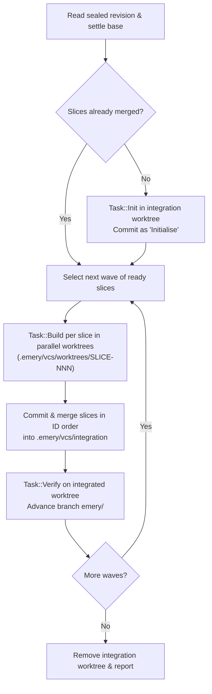

# Wave-based builds and verification

This page explains how Emery partitions a specification into build slices, executes slices concurrently in dependency waves using temporary Git worktrees, resolves merge conflicts, verifies each wave, and resumes interrupted runs. It is for developers and adapter authors who want to understand what happens during `emery build`.

## Contents

- [From specification to build plan](#from-specification-to-build-plan)
  - [Stems, sub-stems, and the slice floor (`SLICE_CAP = 12`)](#stems-sub-stems-and-the-slice-floor-slice_cap--12)
  - [Trigger grouping and data type ownership](#trigger-grouping-and-data-type-ownership)
  - [How `emery amend` updates a plan](#how-emery-amend-updates-a-plan)
- [Execution lifecycle of `emery build`](#execution-lifecycle-of-emery-build)
  - [1. Base settlement and resume check](#1-base-settlement-and-resume-check)
  - [2. Layout initialization (`Task::Init`)](#2-layout-initialization-taskinit)
  - [3. Parallel slice builds (`Task::Build`)](#3-parallel-slice-builds-taskbuild)
  - [4. Deterministic integration and merge resolution](#4-deterministic-integration-and-merge-resolution)
  - [5. Wave verification and labelling (`Task::Verify`)](#5-wave-verification-and-labelling-taskverify)
- [Merge rules and AI conflict resolution](#merge-rules-and-ai-conflict-resolution)
- [Resuming interrupted builds](#resuming-interrupted-builds)
  - [Resuming from the `emery/<id>` branch](#resuming-from-the-emeryid-branch)
  - [Resuming staged slices from `.emery/vcs/integration`](#resuming-staged-slices-from-emeryvcsintegration)
- [See also](#see-also)

---

## From specification to build plan

Before code can be generated, `emery specify` (or `emery amend`) partitions the specification's requirements and the design's domain data types into a dependency-ordered build plan (`plan.json`).

### Stems, sub-stems, and the slice floor (`SLICE_CAP = 12`)

Every requirement has a dotted subject identifier such as `orders.create` or `orders.items.add`. To prevent the planner from shattering cohesive domain logic into tiny fragments, Emery enforces a deterministic **floor** rule (`Floors::check`):

- **Standard stem floor (12 or fewer requirements):** When a stem (the first segment, such as `orders`) has at most 12 requirements (`SLICE_CAP`), the **entire stem** is the floor. All requirements sharing that stem must be placed in the same slice. The planner may merge multiple small stems into a single slice if they cannot be built and verified independently, but it may never split a stem across slices.
- **Sub-stem floor (more than 12 requirements):** When a single stem has more than 12 requirements, Emery lowers the floor for that stem to its **sub-stems** (the first two segments, such as `orders.checkout` and `orders.fulfilment`). The planner may split the stem along sub-stem boundaries into slices of up to 12 requirements, but:
  - It may never split a single sub-stem across slices.
  - It may not cut a stem finer than necessary: if two slices of the same stem could fit together within the 12-requirement cap without creating a dependency cycle, the slicing gate rejects the plan and asks the model to merge them.
- **Single-floor shortcut:** If the entire specification has only one floor, Emery creates a single slice (`SLICE-001`) automatically without making a model call.

### Trigger grouping and data type ownership

In addition to the stem floor, every build plan must satisfy three structural invariants:

1. **Shared triggers stay together:** All requirements reached through the same HTTP `Route:` or `Message:` trigger map to a single handler and must be placed in the same slice, regardless of their stems.
2. **Exclusive data type ownership:** Every `data` type key in `design.json` must be owned by **exactly one** slice—the slice whose requirements read or produce that shape (`mechanism` types are owned by no slice).
3. **Acyclic dependencies (`depends-on`):** Slices declare which other slices they depend on. The slicing gate verifies that all dependencies exist and form a directed acyclic graph (DAG). In pipeline architectures where an entry slice orchestrates stage slices, the entry slice depends on the stages and builds last.

### How `emery amend` updates a plan

When you run [`emery amend`](../reference/cli/amend.md), Emery updates the existing plan deterministically by code wherever possible:

- Existing slices keep their `SLICE-NNN` IDs and names.
- Retired requirements are removed from their slices; if a slice becomes empty, it is removed and its dependants are re-wired to its dependencies.
- Added or restemmed requirements are placed automatically if their trigger or stem floor already belongs to an existing slice.
- Unowned data types are assigned automatically if only one slice was touched and no stems are open.
- Only when requirements fall under a brand-new stem, push a stem past `SLICE_CAP`, or leave data types ambiguous does Emery invoke a slicing turn (`SliceAmend`) to place the open items and refresh touched slice briefs.

---

## Execution lifecycle of `emery build`

When you run [`emery build`](../reference/cli/build.md), Emery reads the sealed revision from your target repository and drives the configured **target adapter** (a WebAssembly component implementing `emery:adapter/target`) wave by wave.

### 1. Base settlement and resume check

Emery resolves the target repository (`.`, `.emery/vcs/repos/<name>` clone, or managed repository), reads the sealed revision, loads the target adapter, and inspects the local branch `emery/<id>` and `.emery/vcs/integration` to see whether any slices from this revision have already been merged.

### 2. Layout initialization (`Task::Init`)

If no slices have been merged yet for this revision, Emery creates the integration worktree at `.emery/vcs/integration` and invokes the target adapter with `Task::Init`:

- The adapter deterministically scaffolds any missing project layout files (such as workspace `Cargo.toml` or `package.json`, shared configuration, and lint rules) using `create_new`, leaving existing files untouched. No language model turn is used.
- In a repository created and managed by Emery, if the layout did not create a `.gitignore`, Emery writes a `.gitignore` ignoring `.emery/`.
- After passing the `spec-rewritten` guard and `secret-detected` gate, the scaffolded files are committed as `Initialise`.

### 3. Parallel slice builds (`Task::Build`)

Emery groups unmerged slices into **waves**: Wave 1 contains all slices with no unmerged dependencies, Wave 2 contains slices whose dependencies were merged in Wave 1, and so on.

Within a wave, Emery builds ready slices concurrently (up to `--jobs <N>` or `EMERY_JOBS`):

1. **Isolated worktree:** For each slice, Emery creates a temporary Git worktree at `.emery/vcs/worktrees/<slice-id>` starting from the wave's base commit.
2. **Typed slice input:** Emery hands `Task::Build(slice)` to the target adapter along with:
   - The slice's ID, name, and prose brief.
   - The typed requirements (`id`, `subject`, `statement`, `scenarios`, and `trigger`) and the specification projection cut to those requirements.
   - The owned `DesignType` keys and signatures alongside the full design.
3. **Adapter scaffolding and model turn:** An SDK-based target adapter (such as `emery:omnia`) can deterministically scaffold module skeletons, route handlers, and test stubs before opening a single gated model turn under its `build.md` prompt. The model implements the slice using `write_files`, `edit_files`, and its sandboxed shell, then returns a `Report` listing `covered` requirement IDs and `written` file paths.
4. **Automatic retry on transient failure:** If a slice build fails due to an upstream model error (`bad_gateway`) or exhausts its time budget, Emery deletes the temporary worktree, creates a fresh one from the wave head, and retries the slice once (`RETRIES = 2`).

### 4. Deterministic integration and merge resolution

After all slice builds in the wave finish, Emery integrates every slice that succeeded **in ascending slice ID order** (`SLICE-001`, `SLICE-002`, ...), regardless of which slice finished first. Integrating successful slices before returning a sibling slice's error ensures completed work is preserved for the next run.

For each built slice:

1. **Head check:** Emery verifies that the slice worktree's `HEAD` commit did not move during the build (protecting against shell commands running `git commit` or `git reset`).
2. **Security gates:** Emery computes the actual pending file changes in the worktree (ignoring whatever `written` list the adapter reported) and checks them against the `spec-rewritten` guard and `secret-detected` gate.
3. **Slice commit and merge:** Emery commits the changes in the slice worktree with structured trailers (`Slice:`, `Revision:`, `Requirements:`, `Covered:`, `Adapter:`, `Base:`, `Wave:`) and merges that commit into `.emery/vcs/integration` using the adapter's merge rules.
4. **Worktree cleanup:** Once merged, the slice's temporary worktree at `.emery/vcs/worktrees/<slice-id>` is removed.

Because slices are merged in deterministic ID order and always branch from the same wave head, `--jobs 1` and `--jobs 8` produce the exact same Git commit graph.

### 5. Wave verification and labelling (`Task::Verify`)

Once a wave's slices are merged into `.emery/vcs/integration`, Emery invokes the target adapter with `Task::Verify` over the integrated worktree:

- The adapter runs workspace-wide checks (such as `cargo clippy`, `cargo test`, `cargo build --target wasm32-wasip2`, or `npm test`) and its own AST structural checks.
- If a check fails, the verification turn can repair the integrated tree using `write_files` and `edit_files` and re-run the checks before returning its `Verdict`.
- If verification passes and left changes in the worktree (such as lockfile updates or cross-slice repairs), Emery runs the security gates and commits them as `Wave <k> verified`. If any modified file falls outside the adapter's `ours` merge rules, the wave is flagged as `repaired`.
- Finally, Emery advances the local branch **`emery/<revision>`** to the verified head commit. The `emery/<revision>` label therefore always points to a verified tree.

---

## Merge rules and AI conflict resolution

When two slices in the same wave modify the same file (for example, registering modules in `src/lib.rs` or adding dependencies to `Cargo.toml`), Emery applies the target adapter's `TargetMetadata.merge_rules` first:

| Merge strategy | Behaviour when both sides modify a matching path | Typical files |
| --- | --- | --- |
| `union` | Keeps lines from both the integrated tree and the slice commit, deduplicated in order. | Barrel exports (`src/index.ts`, `src/lib.rs`), route registries (`src/routes.rs`), workspace manifests (`Cargo.toml`). |
| `ours` | Keeps the integrated tree's version whole. | Generated lockfiles (`Cargo.lock`, `package-lock.json`) that `Task::Verify` refreshes at the end of the wave. |
| `theirs` | Takes the incoming slice's version whole. | Adapter-specific override files. |

*(If only one side modified a file since the wave's base commit, Git takes that side's change automatically regardless of rules.)*

If a path is not covered by a merge rule and conflicts during integration, Emery triggers **AI merge resolution** (`UnresolvedMerge::resolve`):

1. Emery checks that the conflicted path is a regular UTF-8 text file on both sides (if a slice deleted the file or replaced it with a binary/symlink, Emery fails immediately with `merge-unresolved`).
2. Emery sends a `MergeBrief` turn to the model containing both versions of each conflicted file alongside the plan entries of the current slice and the earlier wave slices that touched those files.
3. The model returns the merged file contents (verified to be non-empty and free of `<<<<<<<` conflict markers).
4. Emery writes the resolved files into the slice worktree, runs the security gates, commits them as `<id> <name> resolved at <paths>`, and re-runs the merge using `theirs` on the resolved paths.

---

## Resuming interrupted builds

Emery stores no separate build database. Instead, it resumes interrupted builds directly from the Git history on `emery/<id>` and the integration worktree at `.emery/vcs/integration`.

### Resuming from the `emery/<id>` branch

When `emery build` starts, it checks whether the local branch `emery/<id>` exists and descends from the repository's base commit. If it does, Emery walks the commit log from `emery/<id>` back to the base commit, reading the `Slice:` and `Revision:` trailers on every merge commit. Every slice already merged under `emery/<id>` for the current revision is added to `resumed` and skipped.

### Resuming staged slices from `.emery/vcs/integration`

Suppose Wave 1 has three slices (`SLICE-001`, `SLICE-002`, `SLICE-003`): `SLICE-001` and `SLICE-002` build and merge into `.emery/vcs/integration`, and then `Task::Verify` fails (or `SLICE-003` fails). Emery leaves `.emery/vcs/integration` intact on disk.

When you re-run `emery build`:

1. Emery inspects `.emery/vcs/integration` before recreating it.
2. Seeing that the integration worktree's `HEAD` descends from `emery/<id>` through valid slice merge commits for the current revision, Emery records `SLICE-001` and `SLICE-002` as **staged** (reported in `resumed` and printed as `staged by an earlier run, not built again`).
3. Emery resets the integration worktree cleanly to that merged commit (discarding any uncommitted leftovers from the failed verification), builds only the remaining slice (`SLICE-003`), merges it, and runs `Task::Verify` for the wave.

> [!NOTE]
> Resume applies only within the **same revision**. When you seal an amendment with `emery apply`, the amended specification has a new revision ID (`emery/<new-id>`), so the next `emery build` builds the slices of the new revision over the existing repository tree.

---

## See also

- [Revision lifecycle](revision-lifecycle.md) — how revisions are staged, sealed, and labelled in Git.
- [Security, sandboxing, and gates](security-and-sandbox.md) — how build workers, file writes, and commits are sandboxed and checked.
- [`emery build` CLI reference](../reference/cli/build.md) — flags, JSON output fields, and error codes for `emery build`.
- [Adapters reference](../reference/adapters.md) — how target adapters are referenced, stored, and loaded.
