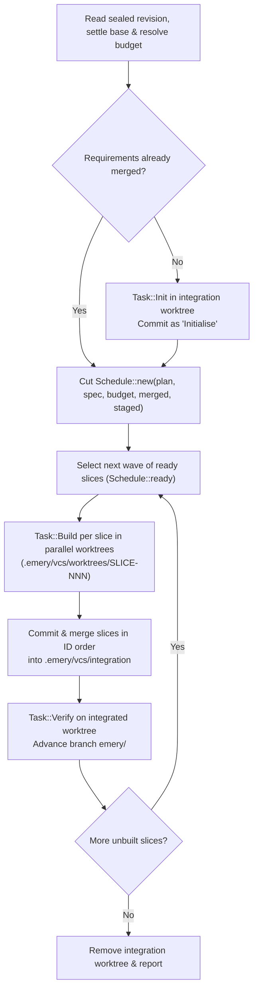

# Wave-based builds and verification

This page explains how Emery partitions a specification into logical build parts during `specify` and `amend`, cuts parts into budget-sized slices during `build`, executes slices concurrently in dependency waves using temporary Git worktrees, resolves merge conflicts, verifies each wave, and resumes interrupted runs. It is for developers and adapter authors who want to understand how `plan.json` turns into a `Schedule` during `emery build`.

## Contents

- [From specification to build plan (`Part`)](#from-specification-to-build-plan-part)
  - [Stems and the part floor](#stems-and-the-part-floor)
  - [Trigger grouping, data type ownership, and dependencies](#trigger-grouping-data-type-ownership-and-dependencies)
  - [How `emery amend` updates a plan](#how-emery-amend-updates-a-plan)
- [From build plan to schedule (`Schedule` and `--budget`)](#from-build-plan-to-schedule-schedule-and---budget)
  - [Choosing the requirement budget](#choosing-the-requirement-budget)
  - [Cutting parts into budgeted slices](#cutting-parts-into-budgeted-slices)
  - [Serial slices within a part, parallel waves across parts](#serial-slices-within-a-part-parallel-waves-across-parts)
  - [Logical modules vs. build slices](#logical-modules-vs-build-slices)
- [Execution lifecycle of `emery build`](#execution-lifecycle-of-emery-build)
  - [1. Base settlement, budget resolution, and resume check](#1-base-settlement-budget-resolution-and-resume-check)
  - [2. Layout initialization (`Task::Init`)](#2-layout-initialization-taskinit)
  - [3. Parallel slice builds (`Task::Build`)](#3-parallel-slice-builds-taskbuild)
  - [4. Deterministic integration and merge resolution](#4-deterministic-integration-and-merge-resolution)
  - [5. Wave verification and labelling (`Task::Verify`)](#5-wave-verification-and-labelling-taskverify)
- [Merge rules and AI conflict resolution](#merge-rules-and-ai-conflict-resolution)
- [Resuming interrupted builds](#resuming-interrupted-builds)
  - [Resuming by committed requirements on `emery/<id>`](#resuming-by-committed-requirements-on-emeryid)
  - [Resuming staged slices from `.emery/vcs/integration`](#resuming-staged-slices-from-emeryvcsintegration)
  - [Changing `--budget` mid-build](#changing---budget-mid-build)
- [See also](#see-also)

---

## From specification to build plan (`Part`)

Emery separates **logical architecture** from **build-turn sizing**:

- During [`emery specify`](../reference/cli/specify.md) and [`emery amend`](../reference/cli/amend.md), the sealed build plan (`plan.json`) organizes requirements and domain data types into logical domain **parts** (`PART-001`, `PART-002`, ...) with no requirement size cap. Because the plan carries no size limit, a sealed revision remains completely independent of the target adapter and the language model used at build time.
- During [`emery build`](../reference/cli/build.md) (and [`emery show schedule`](../reference/cli/show.md)), deterministic engine code cuts any large part into budget-sized **slices** (`SLICE-001`, `SLICE-002`, ...) according to the run's requirement **budget**.

### Stems and the part floor

Every requirement has a dotted subject identifier such as `orders.create` or `orders.items.add`. To prevent the planner from splitting cohesive domain logic across parts, Emery enforces a deterministic **floor** rule (`Floors::check`):

- **Stem floor:** The first segment of a requirement's subject (such as `orders`) is its **stem**, and the entire stem is the floor. All requirements sharing a stem must be placed in the same part, regardless of how many requirements the stem contains. The planner may merge multiple stems into a single part when they cannot be built and verified independently, but it may never split a stem across parts.
- **Single-floor shortcut:** If the entire specification has only one floor, Emery creates a single part (`PART-001`) automatically in code without making a model call.

### Trigger grouping, data type ownership, and dependencies

In addition to the stem floor, every build plan must satisfy three structural invariants:

1. **Shared triggers stay together:** All requirements reached through the same HTTP `Route:` or `Message:` trigger map to a single handler and must be placed in the same part, even when one of them carries a `start.*` subject (such as `start.health-ready-http` on `GET /health/ready`).
2. **Exclusive data type ownership:** Every `data` type key in `design.json` must be owned by **exactly one** part—the part whose requirements create, read, or return that shape (`mechanism` types are owned by no part).
3. **Engine-derived inter-part dependencies (`uses` and `depends-on`):** Parts never declare part-to-part dependencies directly. Instead, each part declares the `data` type keys it owns (`types`) and any `data` type keys its code compiles against without owning (`uses`), while runtime assumptions belong in the part's prose `brief`. The engine derives `depends-on` (`Types::depend`) from the owners of the types referenced in each owned type's signature and the owners of the keys in `uses`, and the slicing gate verifies that every `uses` key is owned by another part and that the derived edges form a directed acyclic graph (DAG).

### How `emery amend` updates a plan

When you run [`emery amend`](../reference/cli/amend.md), Emery updates the existing plan deterministically by code wherever possible:

- Existing parts keep their `PART-NNN` IDs and names.
- Retired requirements are removed from their parts; if a part becomes empty, it is removed and its owned types leave the design.
- Added or restemmed requirements are placed automatically if their trigger or stem floor already belongs to an existing part. Because parts have no size cap, growing an existing stem never forces the planner to re-slice a domain.
- Unowned data types are assigned automatically if only one part was touched and no stems are open, and `depends-on` edges are re-derived across all parts from `types` and `uses`.
- Only when requirements fall under a brand-new stem or leave data type ownership ambiguous does Emery invoke a slicing turn (`PartAmend`) to place the open items and refresh touched part briefs.

---

## From build plan to schedule (`Schedule` and `--budget`)

When [`emery build`](../reference/cli/build.md) runs, the engine combines the sealed `Plan` with a requirement **budget** and constructs a deterministic `Schedule` (`crates/engine/src/build/schedule.rs`). No model turn is used to cut the schedule, and you can preview the exact slices and waves for any budget ahead of time with [`emery show schedule [--budget <N>]`](../reference/cli/show.md#previewing-the-build-schedule-emery-show-schedule).

### Choosing the requirement budget

The **budget** is the maximum number of requirements (`REQ-NNN`) to implement in a single build slice. Emery resolves the budget (`BudgetSource::resolve`) in priority order:

| Priority | Source | Reported `budget-source` |
| --- | --- | --- |
| `1` (highest) | `--budget <N>` / `-b <N>` on the CLI (or `EMERY_BUDGET` in the environment) | `flag` |
| `2` | `[target] budget = <N>` in `emery.toml` | `config` |
| `3` | `TargetMetadata.budget` declared by the target adapter component | `adapter` |
| `4` | Engine fallback (`DEFAULT_BUDGET = 12`) | `default` |

Because the budget is resolved at build time, you can run `--budget 6` for a smaller or faster model or `--budget 16` for a larger model over the exact same sealed specification without re-running `emery specify`.

### Cutting parts into budgeted slices

For each part (`PART-NNN`) in `plan.json`, `Schedule::new` cuts its unbuilt requirements into one or more `ScheduledSlice` entries (`SLICE-001`, `SLICE-002`, ... numbered in schedule order):

1. **Fits within budget:** If the part's requirements are at or below `budget`, the entire part becomes a single slice (`index = 1`, `count = 1`).
2. **Subject prefix and trigger grouping:** If the part exceeds `budget`, Emery groups its requirements by their two-segment subject prefix (`Requirement::substem`, such as `orders.post` or `start.error-conflict`) in first-occurrence order, then merges any groups that share an HTTP route or message trigger (`Floors::shares_trigger`) so a single route or consumer handler is never split across two slices.
3. **Untriggered stages before triggered entries:** Emery orders groups with **no trigger** (pure functions, helpers, and pipeline stages, in requirement ID order) ahead of groups **with a trigger** (HTTP routes and message consumers, in requirement ID order). Building untriggered stages first ensures helper and pipeline functions are implemented and committed before the entry-point handler turn runs.
4. **Next-fit packing and `over-budget` slices:** Groups are packed in order into slices of at most `budget` requirements using next-fit, and each slice's requirement IDs are sorted in ascending `REQ-NNN` order. If a single group exceeds `budget` on its own (for example, a route with 10 requirements under `--budget 6`), Emery keeps the group intact as a single slice and flags it `over_budget: true` (printed as an `over budget:` warning line in terminal output rather than failing the build).
5. **Data type placement:** When a part is cut into multiple slices, all of the part's owned `data` types (`part.types`) travel with its **first slice** (`index == 1`, provided nothing of the part was built yet). Subsequent slices of the part receive `types: []` and import the types already committed by the first slice.

### Serial slices within a part, parallel waves across parts

The schedule orders slices into dependency waves with two rules:

- **Parallel across independent parts:** A part's first slice (`index = 1`) depends on the *last* slice of every part listed in its `depends-on`. Parts with no unbuilt dependencies start in parallel in the same wave.
- **Serial within a part:** When a single part is cut into `count > 1` slices, slice `i + 1` depends on slice `i` and runs in the wave immediately after it.

Running a part's slices serially guarantees that two concurrent build turns never edit the same domain module or crate in the same wave, eliminating intra-part merge conflicts while letting every later slice see the part's data types and earlier functions already committed in its worktree.

### Logical modules vs. build slices

A build slice is a unit of turn budget, not a module boundary. Every `Slice` handed to `Task::Build` carries its logical part's `part` ID (`PART-NNN`), `name`, and `brief` alongside its slice position (`index` of `count`):

- Target adapters derive package and module names from the part's logical `name` and requirement stems—never from numbered slice suffixes (`orders_1.rs` or `orders-2`).
- Slice `1` of `count` scaffolds the part's logical module with its owned data types and initial handlers or functions.
- Slices `2..=count` run in subsequent waves over the committed tree and extend that held module with their remaining handlers, functions, and scenario tests.

---

## Execution lifecycle of `emery build`

When you run [`emery build`](../reference/cli/build.md), Emery reads the sealed revision from your target repository, cuts the `Schedule`, and drives the configured **target adapter** (a WebAssembly component implementing `emery:adapter/target`) wave by wave.

### 1. Base settlement, budget resolution, and resume check

Emery resolves the target repository (`.`, `.emery/vcs/repos/<name>` clone, or managed repository), reads the sealed revision, loads the target adapter, resolves `(budget, budget_source)`, and inspects the local branch `emery/<id>` and `.emery/vcs/integration` to collect the set of `Requirements:` already merged or staged for this revision.

### 2. Layout initialization (`Task::Init`)

If no requirements or staged slices have been merged yet for this revision, Emery creates the integration worktree at `.emery/vcs/integration` and invokes the target adapter with `Task::Init`:

- The adapter deterministically scaffolds any missing project layout files (such as workspace `Cargo.toml` or `package.json`, shared configuration, and lint rules) using `create_new`, leaving existing files untouched. No language model turn is used.
- In a repository created and managed by Emery, if the layout did not create a `.gitignore`, Emery writes a `.gitignore` ignoring `.emery/`.
- After passing the `spec-rewritten` guard and `secret-detected` gate, the scaffolded files are committed as `Initialise`.

### 3. Parallel slice builds (`Task::Build`)

At each wave, `Schedule::ready` selects the next unbuilt slice of every part whose `depends-on` parts have all of their requirements merged. Within the wave, Emery builds ready slices concurrently (up to `--jobs <N>` or `EMERY_JOBS`):

1. **Isolated worktree:** For each slice, Emery creates a temporary Git worktree at `.emery/vcs/worktrees/<slice-id>` starting from the wave's base commit.
2. **Typed slice input:** Emery hands `Task::Build(slice)` to the target adapter along with:
   - The slice's `id` (`SLICE-NNN`), `part` (`PART-NNN`), `index`, and `count`, plus the part's `name`, `brief`, and rendered `plan` block.
   - The slice's typed requirements (`id`, `subject`, `statement`, `scenarios`, and `trigger`) and the specification projection cut to those requirements.
   - The slice's owned `DesignType` keys and signatures (populated on the part's first slice) alongside the design cut to the slice.
3. **Adapter scaffolding and model turn:** An SDK-based target adapter (such as `emery:omnia`) can deterministically scaffold or extend module skeletons, route handlers, and test stubs before opening a single gated model turn under its `build.md` prompt (`Build slice <i> of <count> of part <name> (PART-NNN) as SLICE-NNN`). The model implements the slice using `write_files`, `edit_files`, and its sandboxed shell, then returns a `Report` listing `covered` requirement IDs and `written` file paths.
4. **Automatic retry on transient failure:** If a slice build fails due to an upstream model error (`bad_gateway`) or exhausts its time budget, Emery deletes the temporary worktree, creates a fresh one from the wave head, and retries the slice once (`RETRIES = 2`).

### 4. Deterministic integration and merge resolution

After all slice builds in the wave finish, Emery integrates every slice that succeeded **in ascending slice ID order** (`SLICE-001`, `SLICE-002`, ...), regardless of which slice finished first. Integrating successful slices before returning a sibling slice's error ensures completed work is preserved for the next run.

For each built slice:

1. **Head check:** Emery verifies that the slice worktree's `HEAD` commit did not move during the build (protecting against shell commands running `git commit` or `git reset`).
2. **Security gates:** Emery computes the actual pending file changes in the worktree (ignoring whatever `written` list the adapter reported) and checks them against the `spec-rewritten` guard and `secret-detected` gate.
3. **Slice commit and merge:** Emery commits the changes in the slice worktree with structured trailers (`Slice:`, `Part:`, `Revision:`, `Budget:`, `Requirements:`, `Covered:`, `Adapter:`, `Base:`, `Wave:`) and merges that commit into `.emery/vcs/integration` using the adapter's merge rules.
4. **Worktree cleanup:** Once merged, the slice's temporary worktree at `.emery/vcs/worktrees/<slice-id>` is removed.

Because slices are merged in deterministic ID order and always branch from the same wave head, `--jobs 1` and `--jobs 8` produce the exact same Git commit graph.

### 5. Wave verification and labelling (`Task::Verify`)

Once a wave's slices are merged into `.emery/vcs/integration`, Emery invokes the target adapter with `Task::Verify` over the integrated worktree:

- The adapter runs workspace-wide checks (such as `cargo clippy`, `cargo test`, `cargo build --target wasm32-wasip2`, or `npm test`) and its own AST structural checks.
- If a check fails, the verification turn can repair the integrated tree using `write_files` and `edit_files` and re-run the checks before returning its `Verdict`.
- If verification passes and left changes in the worktree (such as lockfile updates or cross-slice repairs), Emery runs the security gates and commits them as `Wave <k> verified`. If any modified file falls outside the adapter's `ours` merge rules, the wave is flagged as `repaired`.
- Finally, Emery advances the local branch **`emery/<revision>`** to the verified head commit. The `emery/<revision>` label therefore always points to a verified tree.

---

## Merge rules and AI conflict resolution

When two slices in the same wave modify the same file (for example, two parts registering modules in `src/routes.rs` or adding workspace members to `Cargo.toml`), Emery applies the target adapter's `TargetMetadata.merge_rules` first:

| Merge strategy | Behaviour when both sides modify a matching path | Typical files |
| --- | --- | --- |
| `union` | Keeps lines from both the integrated tree and the slice commit, deduplicated in order. | Barrel exports (`src/index.ts`, `src/lib.rs`), route registries (`src/routes.rs`), workspace manifests (`Cargo.toml`). |
| `ours` | Keeps the integrated tree's version whole. | Generated lockfiles (`Cargo.lock`, `package-lock.json`) that `Task::Verify` refreshes at the end of the wave. |
| `theirs` | Takes the incoming slice's version whole. | Adapter-specific override files. |

*(If only one side modified a file since the wave's base commit, Git takes that side's change automatically regardless of rules.)*

If a path is not covered by a merge rule and conflicts during integration, Emery triggers **AI merge resolution** (`UnresolvedMerge::resolve`):

1. Emery checks that the conflicted path is a regular UTF-8 text file on both sides (if a slice deleted the file or replaced it with a binary/symlink, Emery fails immediately with `merge-unresolved`).
2. Emery sends a `MergeBrief` turn to the model containing both versions of each conflicted file alongside the plan entries of the current slice and the earlier wave slices that touched those files.
3. The model returns the merged file contents (verified to be non-empty and free of `<<<<<<<` conflict markers).
4. Emery writes the resolved files into the slice worktree, runs the security gates, commits them as `<id> <name> resolved at <paths>`, and re-runs the merge using `theirs` on the resolved paths.

---

## Resuming interrupted builds

Emery stores no separate build database. Instead, it resumes interrupted builds directly from the Git history on `emery/<id>` and the integration worktree at `.emery/vcs/integration` by tracking which **`Requirements:`** have already been merged.

### Resuming by committed requirements on `emery/<id>`

When `emery build` starts, it checks whether the local branch `emery/<id>` exists and descends from the repository's base commit. If it does, Emery walks the commit log from `emery/<id>` back to the base commit, reading the `Requirements:` and `Revision:` trailers on every slice commit for the current revision. Every requirement ID already committed on `emery/<id>` is added to the `merged` set; slices whose requirements are all in `merged` are recorded in `resumed` and skipped.

### Resuming staged slices from `.emery/vcs/integration`

Suppose Wave 1 has three slices (`SLICE-001`, `SLICE-002`, `SLICE-003`): `SLICE-001` and `SLICE-002` build and merge into `.emery/vcs/integration`, and then `Task::Verify` fails (or `SLICE-003` fails). Emery leaves `.emery/vcs/integration` intact on disk.

When you re-run `emery build`:

1. Emery inspects `.emery/vcs/integration` before recreating it.
2. Seeing that the integration worktree's `HEAD` descends from `emery/<id>` through valid slice merge commits for the current revision, Emery records `SLICE-001` and `SLICE-002` as **staged** (reported in `resumed` and printed as `staged by an earlier run, not built again`).
3. Emery resets the integration worktree cleanly to that merged commit (discarding any uncommitted leftovers from the failed verification), builds only the remaining slice (`SLICE-003`), merges it, and runs `Task::Verify` for the wave.

### Changing `--budget` mid-build

Because resume tracks committed `Requirements:` rather than fixed slice IDs, you can change `--budget` after an interrupted run (for example, lowering `--budget 12` to `--budget 6` if a large part's second slice timed out):

- When you re-run at the **same budget**, every slice of a part's cut aligns with `done`, so slice numbering and `(index/count)` positions stay identical.
- When you re-run at a **different budget** mid-part, `Schedule::new` keeps the part's already-committed requirements together as one resumed slice (`SLICE-NNN`) and packs only the part's remaining unbuilt requirements into fresh slices under the new budget. No requirement is ever built twice.

> [!NOTE]
> Resume applies only within the **same revision**. When you seal an amendment with `emery apply`, the amended specification has a new revision ID (`emery/<new-id>`), so the next `emery build` builds the slices of the new revision over the existing repository tree.

---

## See also

- [Revision lifecycle](revision-lifecycle.md) — how revisions are staged, sealed, and labelled in Git.
- [Security, sandboxing, and gates](security-and-sandbox.md) — how build workers, file writes, and commits are sandboxed and checked.
- [`emery build` CLI reference](../reference/cli/build.md) — flags (`--budget`, `--jobs`), JSON output fields, and error codes for `emery build`.
- [`emery show` CLI reference](../reference/cli/show.md) — previewing the build schedule with `emery show schedule [--budget <N>]`.
- [Adapters reference](../reference/adapters.md) — how target adapters declare default budgets, merge rules, and worker grants.

